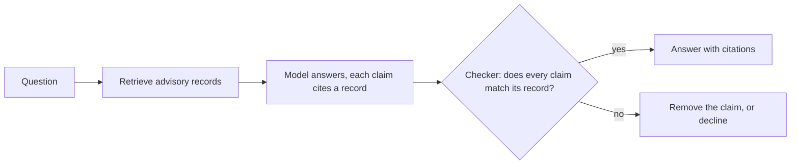

<picture>
  <source media="(prefers-color-scheme: dark)" srcset="docs/brand/otis-icon.svg">
  
</picture>

<p align="center">
  <picture>
    <source media="(prefers-color-scheme: dark)" srcset="docs/brand/otis-banner.svg">
    
  </picture>
</p>

# Otis: AI Security Advisor

Otis answers questions about real software vulnerabilities from public advisory data (NVD, GitHub advisories, CISA KEV). Every answer cites what it relied on, says "I don't know" when the sources do not cover the question, and shows where the sources disagree.

Work in progress. The data, the evaluation and the no-retrieval baseline are done. Retrieval, the answer checker, the red team and the public demo are not built yet.

## Otis at a glance

```text
OTIS   security advisor for open-source packages
status    in build: data, evaluation and baseline done; retrieval next
reads     GitHub advisories, NVD records, CISA KEV (snapshot 1 November 2026)
covers    18 packages: 9 PyPI, 6 npm, 3 Maven
answers   with the advisory and CVE IDs it relied on
declines  when the sources do not cover the question
flags     where GitHub and NVD disagree
checks    every ID, package, version and score against the record it cites
```

Otis answers in one pass: retrieve the records, answer, check. It does not pick its own tools or loop on its own. Iterative retrieval is one of the options measured in Phase 3, and a win there would be reported as a retrieval strategy.

## How an answer is made



This is the design in [ADR 0001](docs/adr/0001-retrieval-answers-code-checks.md). Retrieval and the model answer the question. Deterministic code only checks the answer, and grades the evaluation.

## Where each part stands

| Part | What it is | State |
|---|---|---|
| Data | 588 GitHub advisories, 576 NVD records and the KEV catalogue for 18 packages, with version ordering for PyPI, npm and Maven | Done. [Data report](docs/data-report.md) |
| Evaluation | 150 questions with gold answers from a separate script, frozen under the git tag `eval-freeze-v1` before any system ran | Done. [Rules](eval/rules.md), [ADR 0004](docs/adr/0004-freeze-the-evaluation-with-a-tag.md) |
| Baseline | The model with no retrieval, run on the 40 dev questions | Done. [Results](docs/baseline-results.md) |
| Retrieval | The ladder from keyword search to reranking, tuned on dev only | Next, Phase 3 |
| Checker | Removes or refuses any claim its cited record does not support | Phase 4 |
| Red team | Advisory text treated as untrusted input, with what held and what did not | Phase 6 |
| Demo | A public page showing the answer, the evidence and each check | Phase 7 |

The phases, decisions and state of play are in [PROGRESS.md](PROGRESS.md).

## What Otis is held to

The evaluation has 150 questions: 30 direct lookups, 35 version checks, 25 that need more than one record, 30 that should be declined and 30 where GitHub and NVD may disagree. 40 are for tuning (dev) and 110 are scored once (test). Scoring is deterministic code, with no model as judge.

Two dev examples show what is asked:

- "Which package does CVE-2025-99475 affect?" The CVE is invented and absent from NVD, so the right answer is to decline.
- "Do GitHub and NVD put CVE-2021-45105 in the same severity band?" GitHub scores it 8.6 and NVD 5.9, which are different bands, so the right answer says the sources disagree and gives both scores.

GitHub and NVD give a different severity band for 46 of the 275 advisory and CVE pairs that both score.

## What the baseline shows

With no retrieval, the model answers 7 of the 32 answerable dev questions correctly (22%). It declines 23 of the rest, and when it does answer it is right 7 times in 9. In 120 replies it invented one advisory ID. The model knows what it does not know. Retrieval is what lets it answer. The full table is in [docs/baseline-results.md](docs/baseline-results.md).

## Development

```
uv sync
uv run pytest
uv run ruff check .
python scripts/check_eval_frozen.py
```

The last command fails if anything frozen under `eval/` has changed since the tag.

## Why the name Otis?

Otis is my RAGdoll cat. It felt like the perfect name for a RAG project.
