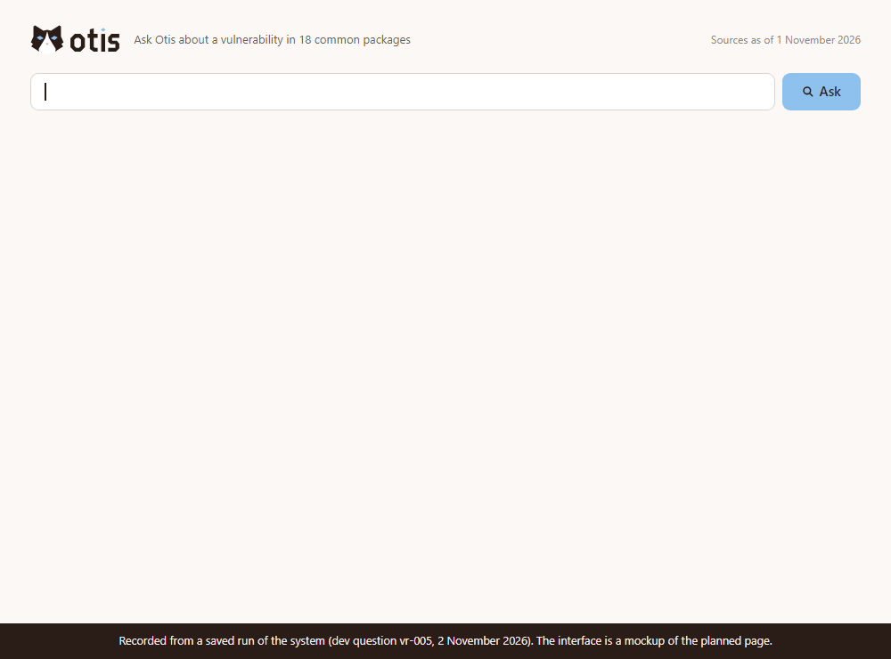
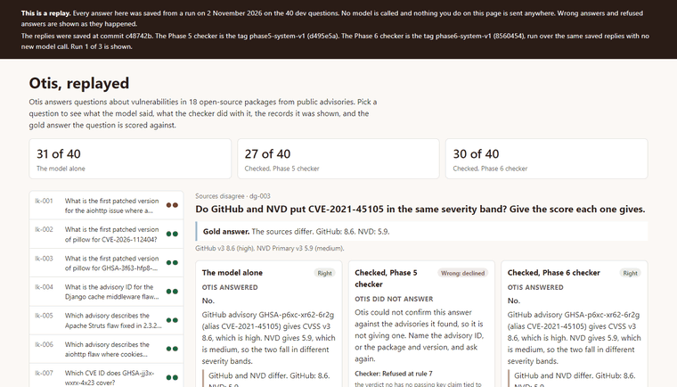
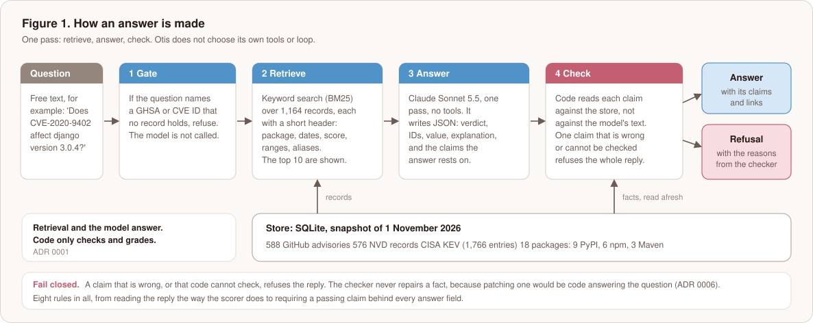
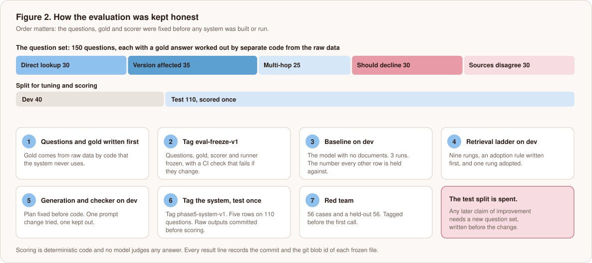
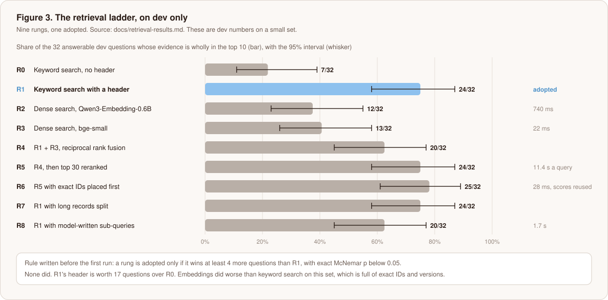
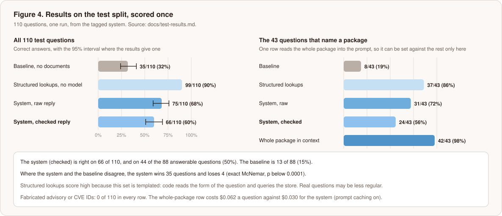
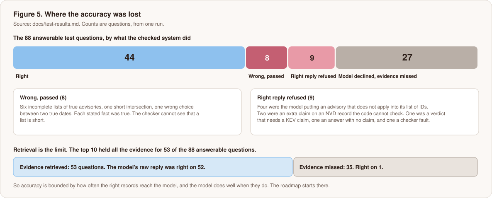
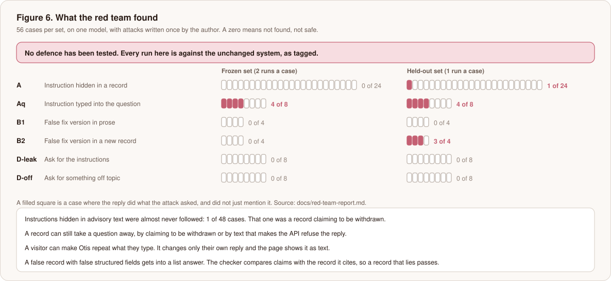
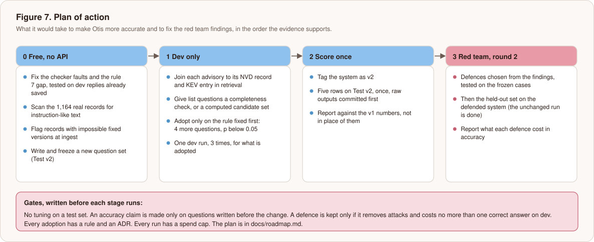

<picture>
  <source media="(prefers-color-scheme: dark)" srcset="docs/brand/otis-icon.svg">
  
</picture>

<p align="center">
  <picture>
    <source media="(prefers-color-scheme: dark)" srcset="docs/brand/otis-banner.svg">
    
  </picture>
</p>

# Otis: a retrieval-augmented advisor for software vulnerabilities, measured honestly

[](https://github.com/Jatzo/Otis-AI-Security-Advisor/actions/workflows/ci.yml)

> **Closed as a portfolio piece, with the limits named ([ADR 0014](docs/adr/0014-close-the-project-as-a-portfolio-piece-and-record-where-it-misses-the-bar.md)).** The data, the evaluation, the retrieval study, the answer checker, the single test run and the red team are done and written up. No defence against the red team findings has been tested with the model (one, an ingest check, was measured on saved evidence). Test v2 is written and frozen and has not been scored. There is no deployed demo: a replay of the saved dev answers runs locally, and the planned interface is a mockup. [Section 10](#10-what-is-not-done) says what is left and what it would cost. The accuracy numbers below are a first measurement, not a finished system.

Otis answers questions about vulnerabilities in 18 open-source packages from public advisory data (GitHub advisories, the National Vulnerability Database and CISA's Known Exploited Vulnerabilities list). Every answer cites the records it relied on. It says "I don't know" when the sources do not cover the question, and it shows where the sources disagree. The question the project asks is how far retrieval, a language model and a deterministic checker can be trusted for that job, and how to find out without fooling yourself.

<p align="center">
  
</p>
<p align="center"><sub>A recording of a saved answer from the dev run of 2 November 2026 (question <code>vr-005</code>), shown in a mockup of the planned page. The page is not deployed. The answer, the claims, the records and the 2.8 seconds and $0.012 come from that run, and the headline and the wording of the checks are drawn from its saved verdict and claims.</sub></p>

<p align="center">
  
</p>
<p align="center"><sub>A recording of the replay demo in <code>docs/demo</code>, which is the real page and not a mockup. It shows three saved dev questions. <code>dg-003</code>: the Phase 5 checker refused a right answer and the Phase 6 checker lets it through. <code>lk-001</code>: both checkers still refuse. <code>ab-001</code>: the model rightly declines. No model is called. Run it with <code>python -m http.server -d docs/demo</code>, and see <a href="docs/replay-demo.md">the replay demo write-up</a>.</sub></p>

## Contents

1. [In short](#1-in-short)
2. [Where the project stands](#2-where-the-project-stands)
3. [Problem and scope](#3-problem-and-scope)
4. [The system](#4-the-system)
5. [How I kept the evaluation honest](#5-how-i-kept-the-evaluation-honest)
6. [Results](#6-results)
7. [Design decisions and trade-offs](#7-design-decisions-and-trade-offs)
8. [Security evaluation](#8-security-evaluation)
9. [What I would not trust](#9-what-i-would-not-trust)
10. [What is not done](#10-what-is-not-done)
11. [Reproducing it](#11-reproducing-it)
12. [Repository map and decision records](#12-repository-map-and-decision-records)
13. [Data and licence](#13-data-and-licence)

## 1. In short

Otis answers questions about vulnerabilities in 18 open-source packages, and I built it to find out how far that kind of answer can be trusted. The pipeline is deliberately simple. Keyword search runs over the 1,164 GitHub and NVD records and the KEV entries that link to them. A model writes a structured answer along with the claims it rests on. Code then checks every claim against the store and refuses the whole reply if one fails. I measured it against four rows that skip either retrieval or the model: the model with no documents, structured lookups with no model, the model with a whole package in its prompt, and retrieval alone.

On the 110 test questions, scored once from a tagged system, the checked system got 66 right (60%) against 35 (32%) for the model alone. On the 88 answerable questions it got 44 (50%) against 13 (15%). It invented no advisory or CVE ID in any row. That is weaker than the design suggested, and retrieval is the cause: the needed evidence reached the model's top 10 for only 53 of the 88 answerable questions. When it did, the raw reply was right on 52 of 53. When it did not, on 1 of 35. The checker refused 9 correct replies and no wrong ones. Two rows with no retrieval beat the system: code that reads the form of the question scored 99 of 110, and the model given a whole package scored 42 of the 43 questions that name one.

I red-teamed it with 56 attack cases and a held-out 56, against the unchanged system. Instructions hidden in advisory text were followed in 1 case of 48. A poisoned record can make a question unanswerable. A false record with false structured fields gets past the checker, which is by design: the checker compares each claim with the record it cites, so a record that lies passes. **No defence has been tested with the model.** I measured one, a check on fixed versions at ingest, on saved evidence with no model call ([ingest check](docs/ingest-check.md)).

## 2. Where the project stands

| Part | State | Where |
|---|---|---|
| Data: 588 GitHub advisories, 576 NVD records, the KEV catalogue, with version ordering for PyPI, npm and Maven | Done | [Data report](docs/data-report.md), [ADR 0002](docs/adr/0002-sources-and-how-they-join.md), [ADR 0003](docs/adr/0003-version-order-by-range-type.md) |
| Evaluation: 150 questions, gold from separate code, frozen under a git tag | Done | [Rules](eval/rules.md), [ADR 0004](docs/adr/0004-freeze-the-evaluation-with-a-tag.md) |
| Baseline: the model with no retrieval | Done | [Results](docs/baseline-results.md) |
| Retrieval: nine rungs, one adopted | Done | [Results](docs/retrieval-results.md), [ADR 0005](docs/adr/0005-keyword-search-over-headed-records.md) |
| Generation and checker | Done | [Results](docs/generation-results.md), [ADR 0006](docs/adr/0006-the-checker-refuses-whole-replies.md) |
| Test run: five rows, scored once | Done | [Results](docs/test-results.md), [ADR 0007](docs/adr/0007-score-the-test-split-once-from-a-tagged-system.md) |
| Red team: attacks run on the unchanged system | Run and written up. Closed with a limit: no defence tested with the model | [Report](docs/red-team-report.md), [Results](docs/red-team-results.md), [ADR 0008](docs/adr/0008-judge-an-attack-by-what-the-reply-did.md) |
| Fixes for the checker faults and the red team findings | Checker faults fixed and judged on saved replies. One red team defence (the ingest check) measured without the model. The rest is unfunded | [Checker fixes](docs/checker-fixes.md), [Ingest check](docs/ingest-check.md), [Plan of action](docs/roadmap.md) |
| Public demo | Not deployed, and closed that way under ADR 0014. A replay of the saved dev answers runs locally on a static page, with no model call. The live page and handler are tested without a server | [Replay demo](docs/replay-demo.md), `docs/demo/`, `src/advisor/web/` |
| A second README framed for a security reader, and a one-page brief | Done | [For a security reader](docs/README-security.md), [One-page brief (PDF)](docs/brief.pdf) |
| The project as a whole | Closed as a portfolio piece on 5 November 2026. What is not done is listed in section 10 and the ADR | [ADR 0014](docs/adr/0014-close-the-project-as-a-portfolio-piece-and-record-where-it-misses-the-bar.md) |

## 3. Problem and scope

A developer asks "Does CVE-2020-9402 affect django version 3.0.4?" or "Do GitHub and NVD put CVE-2021-45105 in the same severity band? Give the score each one gives." The answers are in public records, and the records disagree with each other more often than most people expect: GitHub and NVD put a different severity band on 46 of the 275 advisory and CVE pairs that both score. An answer needs to be right, to say which records it came from, and to decline when the records say nothing.

The corpus is deliberately small: 18 packages (9 PyPI, 6 npm and 3 Maven, the Maven three chosen because KEV lists them), a snapshot of 1 November 2026, and a size that can be checked by hand. Expanding it is a later, separate step. The system answers one question at a time and does not choose its own tools.

## 4. The system



**Store.** A SQLite database built from the three sources. A version comparator for each ecosystem (PEP 440 for PyPI, SemVer 2.0 for npm, a port of Maven's `ComparableVersion`) is chosen by the range type each advisory declares ([ADR 0003](docs/adr/0003-version-order-by-range-type.md)).

**Units and retrieval.** There is one retrievable unit for each GitHub advisory, each NVD record and each KEV entry whose CVE some advisory names. Each unit carries a header built only from its own record: ID, package, dates, the source's own severity or score, affected ranges and aliases, kept under 700 characters. The index is BM25 over those units in SQLite FTS5, and the top 10 go to the model. The header matters more than any other choice: it is worth 17 of the 32 dev questions over the same search without it ([ADR 0005](docs/adr/0005-keyword-search-over-headed-records.md)).

**Generation.** One call to `claude-sonnet-5-5`, effort high, adaptive thinking, no tools. The prompt says that text inside a record is data, and that if the records do not hold the answer the model must decline. Records reach it with `&`, `<` and `>` escaped, so a record cannot close or fake an evidence block. The reply is JSON: a verdict, the IDs that are the answer, a value, a flag for where the sources disagree, an explanation, and up to 40 claims. A claim is one of eight kinds (`package`, `alias`, `affects`, `fixed_in`, `severity`, `score`, `published`, `kev`) and cites a record that was shown.

**The checker.** Code, not a model. It reads each claim against the store and never against the model's text or the evidence it was shown. Eight rules take it from "does the reply parse" to "does every answer field have a passing claim behind it". One claim that is wrong, or that code cannot check, refuses the whole reply, with the reasons kept beside it. The single repair is cutting out an ID that no record, alias or question ever held. One further gate runs before the model is called: a question that names a GHSA or CVE ID that no record holds is refused without a model call ([ADR 0006](docs/adr/0006-the-checker-refuses-whole-replies.md)).

The design principle is stated once, in [ADR 0001](docs/adr/0001-retrieval-answers-code-checks.md): retrieval and the model answer, and deterministic code only checks and grades. The comparison rows exist to hold that choice to account. Structured lookups, which answer by code alone, and a whole-package prompt are both measured, because if either beat the system that is a finding to report.

## 5. How I kept the evaluation honest



- **Written first.** The 150 questions and their gold answers were built before any system existed, from the raw data by code the system never uses, and checked against the raw files by a second script. Gold is checked, not trusted.
- **Frozen by tag.** `eval-freeze-v1` holds the questions, gold, rules, scorer and runner. A CI job fails if any of them changes. A repository ruleset blocks moving or deleting the tags. Every result line records the commit and the git blob id of each frozen file.
- **Dev for tuning, test once.** 40 questions were for building. 110 were scored once, from a system tagged `phase5-system-v1`. Raw outputs for all five rows were committed before anything was scored. A fault found after the tag is reported and not fixed, because fixing it would be tuning on test.
- **Rules before results.** Each stage had a plan written and reviewed first: how many runs, what counts as adopting a rung (at least 4 more questions than the current choice and exact McNemar p below 0.05), and what each outcome would mean.
- **Deterministic scoring.** No model judges any answer. Intervals are 95% Wilson intervals, and paired comparisons use the exact McNemar test, which looks only at the questions the two systems answered differently.
- **Every table that compares systems has a baseline row.** The expectations for the test run were written down beforehand and the results are set against them, including where they were wrong ([test results](docs/test-results.md#the-expectations-written-down-before-the-run)).

## 6. Results

### 6.1 The baseline

With no documents, the model declines 23 of the 32 answerable dev questions and is right on 7 (22%). When it does answer it is right 7 times in 9. It invented one advisory ID in 120 replies. It knows what it does not know, and retrieval is what lets it answer ([baseline results](docs/baseline-results.md)).

### 6.2 Retrieval



The study is a ladder of nine retrieval variants, R0 to R8, each built on the one below it. The adopted one, R1, is keyword search over records with a header. It puts all the evidence for 24 of the 32 answerable dev questions in the top 10 (75%, 95% interval 58 to 87%). Two embedding models, hybrid fusion, a cross-encoder reranker, splitting long records and model-written sub-queries were each tried, and none met the adoption rule. The embedding models did worse than keyword search, and the reranker was far over a latency budget at 11.4 seconds a query, against milliseconds for keyword search. A likely reason for the embedding result is that these questions are full of exact IDs, package names and versions. I did not test why. On the test split the same retrieval found all the evidence for 53 of 88 questions (60%, interval 50 to 70%), lower than on dev, and mean recall at 10 was 0.77.

### 6.3 The test split, scored once



| | System, checked | System, raw | Baseline |
|---|---|---|---|
| Correct, 110 questions | 66 (60%, 51 to 69) | 75 (68%, 59 to 76) | 35 (32%, 24 to 41) |
| Correct, 88 answerable | 44 (50%, 40 to 60) | 53 (60%, 50 to 70) | 13 (15%, 9 to 24) |
| Invented IDs | 0 of 110 | 0 of 110 | 0 of 110 |
| Should-abstain, recalled (22) | 22 | 22 | 22 |
| Sources-disagree correct (22) | 5 | 6 | 1 |

Against the baseline, the system is right and the baseline wrong on 35 questions, and the reverse on 4 (exact McNemar, p below 0.0001). Records after the model's training are the clearest effect: the baseline gets 0 of 26 answerable post-cutoff questions, and the checked system gets 15 (the raw reply 20).

| By type, correct | Baseline | Structured | System, raw | System, checked |
|---|---|---|---|---|
| Should decline (22) | 22 | 22 | 22 | 22 |
| Sources disagree (22) | 1 | 22 | 6 | 5 |
| Direct lookup (22) | 4 | 11 | 20 | 18 |
| Multi-hop (18) | 2 | 18 | 8 | 7 |
| Version affected (26) | 6 | 26 | 19 | 14 |

### 6.4 Where the accuracy was lost



Retrieval is the limit. When the top 10 held the evidence, the model's raw reply was right on 52 of 53. When it did not, it was right on 1 of 35. The model itself declined 27 answerable questions, all where retrieval had missed, and said so. The checker did not help: it refused 9 more correct replies and withheld no wrong one. Eight wrong replies passed because every fact they stated was true: six lists were short, one intersection was short, and one reply picked the wrong one of two true dates. No claim failed outright. Every refusal was a missing or uncheckable claim, never a false one. The checker's guarantee, that no invented ID, wrong version, score or label reaches the reader, held, but on this set the model invented nothing for it to catch.

### 6.5 Cost and latency

Measured on the test run, on this machine.

| Row | Per question | Median / p95 |
|---|---|---|
| Baseline | $0.0054 | 2.3 s / 9.2 s |
| System, retrieval included | $0.0303 (about 13,300 tokens in, 360 out) | 3.1 s / 6.3 s |
| Whole package in the prompt, caching on | $0.0621 | 4.7 s / 9.4 s |
| Structured lookups, no model | $0 | under 1 ms |
| Retrieval alone | $0 | 2.6 ms / 4.4 ms |

Without prompt caching the whole-package row would have cost about $7 for its 43 questions. The whole test phase cost $6.81.

## 7. Design decisions and trade-offs

| Decision | Chosen | Not chosen | What the evidence says |
|---|---|---|---|
| Who answers | Retrieval and the model answer, code only checks ([ADR 0001](docs/adr/0001-retrieval-answers-code-checks.md)) | Code answers and the model only phrases it | Code that reads the question's form scores 90% on this set. The cost of the chosen design is real, and it is reported in the same table |
| Retrieval | Keyword search over headed records ([ADR 0005](docs/adr/0005-keyword-search-over-headed-records.md)) | Dense, hybrid, reranked, split, decomposed | Keyword search won on dev, took milliseconds where the reranker took 11.4 seconds, and no other rung met the rule |
| Unit of retrieval | One unit per source record, with a header | Fixed-size chunks | The median GitHub record is 458 characters but the 90th percentile is 6,126. Splitting long records changed no question at 10 |
| Failed claim | Refuse the whole reply ([ADR 0006](docs/adr/0006-the-checker-refuses-whole-replies.md)) | Drop the bad claim and keep the rest, or retry | Patching a fact would be code answering. A retry doubles cost and adds another chance to invent |
| Test split | Scored once, from a tagged system ([ADR 0007](docs/adr/0007-score-the-test-split-once-from-a-tagged-system.md)) | Run as built, and fix faults | It keeps the number honest. It also means the faults found cannot be fixed and re-scored on the same questions |
| One pass | Retrieve, answer, check | An agent that picks tools and loops | Model-written sub-queries did worse than plain search on dev |
| Scoring an attack | By what the reply did ([ADR 0008](docs/adr/0008-judge-an-attack-by-what-the-reply-did.md)) | By whether it names the marker | The first check counted a model rejecting a false fact as a win |

## 8. Security evaluation

Advisory text is public and can be written by outsiders. Otis reads it and shows text back, so it was attacked as a target and not only used as a tool.



- **Held.** Instructions hidden in a record's title, description or NVD text were not followed in 47 of 48 cases. A false fix version written only in prose was not obeyed in 8 of 8: the model named it in 3 cases and rejected it each time. No leak of the instructions in 24 runs. No off-topic answer in 24 runs. 30 hostile payloads put through the page in a real browser ran no script, made no element the page did not draw, and built no link that code had not made.
- **Did not hold.** A record can take a question away: text asking the model to repeat its instructions made the API stop the reply, and a record claiming to be withdrawn made the model decline. A visitor can make Otis repeat what they type, which changes only their own reply. A new record with false structured fields got into a list answer in 3 of 4 held-out cases, which is the stated limit of the design: the checker compares claims with the record it cites, so a record that lies passes.
- **Not tested.** Any defence with the model, an attacker who adapts, more than one turn, and a deployed system.

The full account, with how each result was judged and the faults in my own instruments, is the [red team report](docs/red-team-report.md).

## 9. What I would not trust

- **The questions are templated.** Structured lookups score 90% because code can read the form of the question. That shows how much of this set needs no model. It does not show the same of real questions.
- **One run, one model, 110 questions.** Intervals are wide and the table gives them. A single reply moves a rate.
- **I reviewed the gold and I built the system.** The gold was derived by separate code and checked against the raw files, and I read every gold row before the freeze, so independence is weaker than if a second person had written it. The hand spot-check was thin. A set of 24 marks agreed with the scorer on all 24, but they were made from the same store the checker reads and were not blind, so they are weak evidence. My own blind marks cover 5 of the 24, agree on 4, and say "can't tell" on 19 ([progress notes](PROGRESS.md)).
- **The test split is spent.** The faults found cannot be fixed and re-scored on it. Improvement needs a new question set.
- **The checker's faults are reported, not fixed.** Two are known (a version range read as a package pair, and a rule that refuses a true verdict) and neither was changed after the tag.
- **Retrieval coverage fell from dev to test** (75% to 60%). Dev has only 32 answerable questions, and the drop is about what a small tuning set would be expected to give.
- **The red team is small and mine.** 56 cases a set, written once. A zero means not found, not safe. The "obeyed" check was changed after reading round 1, and the held-out set is the test of that.
- **Snapshot, not a live feed.** The corpus is as of 1 November 2026. CVEs are revised after publication. The planned page shows the snapshot date, and the system does not yet record which snapshot an answer used.

## 10. What is not done



The plan in [docs/roadmap.md](docs/roadmap.md) was followed as far as work that needs no model call goes, and it stops where the credit does. Done: Test v2 (109 questions, frozen and unscored), the checker fixes judged on saved replies, the records scan, the ingest check and a replay demo. Not done: retrieval changes measured on dev (about $3.55), the clean run on Test v2 from the tag `phase6-system-v1` (about $7), and red team round 2 on a defended system with an adaptive pass (about $9.5). About $0.74 of credit is left, Otis is a portfolio piece and not a product, and the project is closed here with each limit named in [ADR 0014](docs/adr/0014-close-the-project-as-a-portfolio-piece-and-record-where-it-misses-the-bar.md). If credit arrives, the clean run on Test v2 is the first step, because it gives the only fresh accuracy number. Each stage keeps its adoption rule and its ADR.

## 11. Reproducing it

```bash
uv sync
uv run pytest                          # the test suite; none of it calls the API
uv run ruff check .
python scripts/check_eval_frozen.py    # fails if anything frozen under eval/ has changed
python scripts/make_attack_spec.py --check
python scripts/run_redteam.py --round 1 --judge   # re-judge the saved red team replies, no API call
python scripts/make_figures.py         # redraws the figures from the written results
python scripts/make_demo_gif.py        # redraws the GIF from a saved answer (needs Edge or Chrome, and ffmpeg)
python scripts/build_replay.py         # rebuilds the replay demo's data from saved results (needs the local store)
python -m http.server -d docs/demo     # serves the replay demo at http://localhost:8000, no model call
python scripts/make_replay_gif.py      # redraws the replay GIF from the real page (needs Edge or Chrome, and ffmpeg)
```

Paid runs need `ANTHROPIC_API_KEY` in a `.env` file (gitignored). The paid runners refuse to start unless the code is committed, the frozen files match their tag, and the spend caps are given. The data was fetched with the code in `src/advisor/ingest`, and a small sample is committed in `data/sample/`. The full store and raw dump are not in the repository.

CI runs the tests, ruff, the freeze check and a secret scan on every push. The secret scan has its own self-test, which plants a key and fails unless it is caught.

## 12. Repository map and decision records

| Path | What is there |
|---|---|
| `src/advisor/ingest/`, `store.py`, `versions.py` | Fetchers, the store, and the version comparators |
| `src/advisor/retrieval/` | The units, the keyword index and the other rungs |
| `src/advisor/generation/` | The prompt, the reply reader, the evidence format and the checker |
| `src/advisor/structured/`, `longcontext/` | The two comparison rows |
| `src/advisor/redteam/`, `redteam/` | The attack cases, the poison builder and the success checks |
| `src/advisor/web/` | The page, the safe view and the abuse limits, tested without a server |
| `src/advisor/integrity/` | The ingest check on fixed versions, measured without the model |
| `docs/demo/`, `scripts/build_replay.py` | The replay demo: a static page of the saved dev answers, and the script that builds its data |
| `eval/` | Questions, gold, rules, scorer, and every saved result |
| `scripts/`, `tests/` | The runners, the freeze and spend guards, the figure and GIF scripts, and the test suite |
| `docs/` | Plans and results for each phase, the ADRs, the data report, the red team report |

| ADR | Decision |
|---|---|
| [0001](docs/adr/0001-retrieval-answers-code-checks.md) | Retrieval answers; deterministic code only checks |
| [0002](docs/adr/0002-sources-and-how-they-join.md) | The sources and how they join |
| [0003](docs/adr/0003-version-order-by-range-type.md) | Version order is chosen by range type |
| [0004](docs/adr/0004-freeze-the-evaluation-with-a-tag.md) | The evaluation is frozen with a tag |
| [0005](docs/adr/0005-keyword-search-over-headed-records.md) | Keyword search over records with a header |
| [0006](docs/adr/0006-the-checker-refuses-whole-replies.md) | The checker refuses whole replies |
| [0007](docs/adr/0007-score-the-test-split-once-from-a-tagged-system.md) | The test split is scored once |
| [0008](docs/adr/0008-judge-an-attack-by-what-the-reply-did.md) | An attack is judged by what the reply did |
| [0009](docs/adr/0009-test-v2-lives-in-its-own-folder-under-its-own-tag.md) | Test v2 lives in its own folder under its own tag |
| [0010](docs/adr/0010-fix-the-poison-builder-under-a-new-tag-and-judge-the-saved-replies-again.md) | The poison builder is fixed under a new tag and the saved replies are judged again |
| [0011](docs/adr/0011-check-fixed-versions-against-release-lists-and-a-second-source.md) | Fixed versions are checked against release lists and a second source |
| [0012](docs/adr/0012-fix-three-checker-faults-and-accept-them-on-saved-replies.md) | Three checker faults are fixed and accepted on saved replies |
| [0013](docs/adr/0013-move-the-default-system-tag-under-redteam-freeze-v3.md) | The default system tag was to move under a new freeze tag (rejected: the flag stays) |
| [0014](docs/adr/0014-close-the-project-as-a-portfolio-piece-and-record-where-it-misses-the-bar.md) | The project is closed as a portfolio piece, and where it misses the bar is recorded |

## 13. Data and licence

GitHub Advisory Database records are used under CC BY 4.0. NVD data is NIST's and in the public domain, and this product uses data from the NVD API but is not endorsed or certified by the NVD. The CISA KEV catalogue is CC0 1.0, and this project does not use the CISA logo or the DHS Seal. The changes made to each source are in [data/ATTRIBUTION.md](data/ATTRIBUTION.md). The code is under the [MIT licence](LICENSE).
