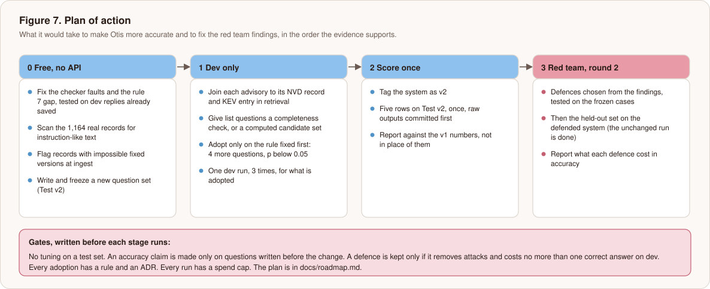
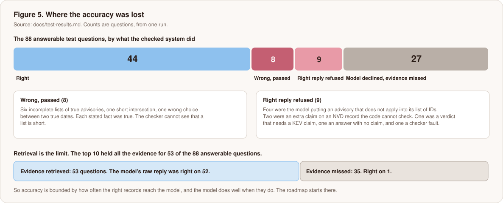

# Plan of action: a more accurate Otis, and fixes for the red team findings

This is a plan, not a result. Nothing in it has been built or run. Every figure quoted is from the results already written up: [test-results.md](test-results.md), [retrieval-results.md](retrieval-results.md) and [red-team-report.md](red-team-report.md). Costs are estimates scaled from what each kind of run has cost so far.

## The rule that shapes everything

The test split was scored once and is spent. Fixing a fault I saw on it, and then scoring it again, would be tuning on test. So any claim that Otis got better has to be made on a **new question set, written and frozen before the change** (called Test v2 below). The v1 numbers stay in the write-up as they are, and v2 is reported beside them, not in place of them.

Tuning happens on dev only. Each change gets an adoption rule written first: at least 4 more questions than the current system on dev, with exact McNemar p below 0.05, as in the retrieval ladder. Each adoption gets an ADR.

## Where the accuracy is lost

Two levers, in order of how much evidence points at them.

1. **Retrieval.** The top 10 held all the evidence for 53 of the 88 answerable test questions, and the model's raw reply was right on 52 of those 53. Where it was missed (35 questions), the raw reply was right once. So the ceiling is about how often the right records reach the model, times roughly 98%. Misses were worst on sources-disagree (16 of 22), multi-hop (9 of 18) and version lists (8 of 26).
2. **The checker.** It refused 9 replies that were right, and passed 8 that were wrong. It never withheld a wrong answer. It cost more than it gave on this set.

## Accuracy: what to do, and how each is judged

### A1. Fix the checker faults (free)
- **What.** Three known causes account for 6 of the 9 refusals: a version range inside a description read as a package and version pair (`lk-015`), a verdict set on a sources-disagree answer that then needs a KEV claim (rule 7), and an advisory the model lists in `ids` while saying it does not apply (4 of the 9). Two more are a `fixed_in` claim on an NVD record that has no version rows, which code cannot check, and that needs a decision. The ninth is an answer that came with no claim, where the refusal is the checker doing its job.
- **How it is tested.** On the saved dev replies, with `--recheck`, which calls no model. Each fix must keep every dev reply that was correctly refused refused.
- **What it can give.** At most the 9 questions on the v1 set (66 up to 75 of 110, the raw count), and only if it lets no wrong reply through. That is an upper bound, not a forecast. It is checked on Test v2.
- **Cost.** Nothing in model calls.

### A2. Put the linked records in front of the model (dev, then v2)
- **What.** When an advisory is retrieved, also bring its NVD record and any KEV entry. The sources-disagree and multi-hop misses need both a GitHub advisory and its NVD record, and KEV recall at 10 was 0.0 on dev and 0.4 on test. This was named as the next untested change in the Phase 3 write-up.
- **How it is tested.** Retrieval alone is free: all-evidence at 10 on the 32 dev answerable questions, against 24 for R1, under the adoption rule. The prompt grows, so cost and latency are reported. The system now sends about 13,300 tokens in and costs $0.030 a question.
- **Cost.** Free to measure retrieval. One dev generation run of 3 x 40 questions is about $3.55 if it passes.

### A3. Lists that the top 10 cannot hold
- **What.** Six of the 8 wrong passes were lists with advisories missing. The top 10 cannot hold five or six advisories next to everything else a keyword search returns. Two options, which can be combined:
  - **A completeness check.** For a "which advisories affect X version Y" question, the checker works out the full set from the stored ranges and refuses a shorter list. This is still only checking, so it fits [ADR 0001](adr/0001-retrieval-answers-code-checks.md). It turns wrong passes into refusals. It cannot raise the number of correct answers.
  - **A computed candidate record.** Give the model a record that code built from the version ranges, labelled as computed, and let the model answer from it, with the same claims checked. It moves toward the structured row, which got 26 of 26 on version questions, so it needs its own ADR and a plain statement of what it does to the "retrieval answers" claim.
- **How it is tested.** On dev, under the same adoption rule.

### A4. Over-abstention follows from A2 and A3
The model declined 27 answerable questions, all where retrieval missed, and the checker refused 9 more. No prompt change is planned for it: the model declined because it saw nothing relevant, and that was the right call on what it saw.

### A5. The whole-package option, as a cost question
Putting a whole package in the prompt got 42 of 43 package-naming questions at $0.062 a question, twice the system's cost, with a median of 4.7 seconds. It is a legitimate rung to price against retrieval, as a package-scoped retrieval rung on dev. It is not planned to replace retrieval.

### A6. Left alone
Dense retrieval and reranking did worse than keyword search, or were far too slow (11.4 seconds a query for the reranker). They are revisited only if the new question set is full of described advisories where the words differ from the record's text.

## The new question set (Test v2)

About 110 questions, written and frozen before any change in Phase 1, with gold from code that does not touch the system. It adds what v1 lacks: more described-in-other-words lookups (v1 has 11 of 22), more multi-hop and list questions, and a share where the question's form is not one the structured row can read, so that row stops being a ceiling. The v1 caveat that the questions are templated is then partly answered. The cost is a day of work and no model calls.

## Red team: what to do about each finding

| Finding | What it is | Planned fix | Tested how | Cost |
|---|---|---|---|---|
| 2. A record takes a question away | Text asking for the instructions makes the API stop the reply; a record claiming to be withdrawn made the model decline | Scan the 1,164 real records for instruction-like and "withdrawn" text to learn the false positive rate (done, 4 by mistake and 0 after one fix, see [records-scan.md](records-scan.md)). If it is low, hold such records back at retrieval. Separately, when the API refuses a reply, tell the visitor so, and name the likely cause | The scan is free. The frozen and held-out A cases run on the defended system | Scan free, about $5.3 for the runs |
| 3. A visitor's own instruction is followed | Made-up token, web address and a real ID the question was not about | Strip web addresses from the explanation unless the code built them, and treat any text outside the JSON as an error. Decide on the rest: it changes only that visitor's reply, so it may be accepted and documented | The Aq cases | Same runs |
| 4. A false record passes (B2) | The checker compares claims with the record, so a record that lies passes | Cross-check each record's ranges against a second source at ingest, and flag a fix version no release has reached. A flagged record is shown as unverified or left out. This is a data defence, not a model one | Free: apply the frozen B2 records to the ingest check and see whether they are flagged (done, see [ingest-check.md](ingest-check.md) and ADR 0011). The poison builder, which gave npm records the wrong range type, is fixed (ADR 0010) | Free |
| Gaps in what was tested | One model, attacks written once, no adaptive attacker | An adaptive pass: a few rounds of rewriting attacks that nearly worked, capped at about $1 | By hand, reported separately | About $1 |

A defence is kept only if it removes at least 3 successes in its class on the frozen set, holds on the held-out set, and costs no more than one correct answer on dev. The held-out set has been run on the unchanged system and is run once more on the defended one, as the plan said. A rate limiter, a spend cap and a topic gate already exist as code and tests (see the red team report) but were not in the system that was attacked.

## Order, cost and gates

| Stage | Work | Model calls | Estimated cost |
|---|---|---|---|
| 0 | A1 on saved replies, the records scan, the ingest check, the poison builder fix, Test v2 written and tagged | None | $0 |
| 1 | A2 and A3 on dev. Retrieval measured free; one 3-run generation check for whatever passes | 120 calls if one change is adopted | about $3.55 |
| 2 | Tag the system as v2. Five rows on Test v2, once. Raw output committed before scoring | The five rows | about $7 (v1 cost $6.81) |
| 3 | Red team round 2: the frozen set and the held-out set on the defended system, a dev check for what it costs in accuracy, the adaptive pass. The held-out set on the unchanged system is already run | About 200 calls, and a 3-run dev check | about $9.5 |

About $20 in all at the prices measured so far, and none of it is needed to write the project up. Each stage has a spend cap before it starts. Nothing moves to the next stage until the previous one is written up, including what did not work.

## What this plan will not do

- Report a gain on the v1 test split. It cannot, because that split was scored once.
- Promise a number. The bounds above are bounds. The targets are hypotheses, and the adoption rules decide.
- Add a defence because it sounds right. Each one is measured against what it costs in accuracy.
